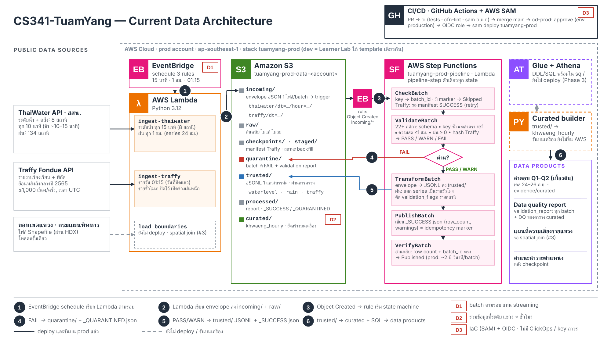

# CS341-TuamYang
CS341 Term Project: Bangkok flood risk data pipeline (water level vs bank height + Traffy Fondue flood reports, by khwaeng)

## ภาพรวม

ระบบดึงข้อมูลจริงจาก 2 แหล่ง คือ ระดับน้ำ 8 สถานีและปริมาณฝนจาก ThaiWater (สสน.) กับรายงานปัญหาจาก Traffy Fondue แล้วตรวจคุณภาพข้อมูลทุก batch ก่อนรวมเป็นตาราง `khwaeng_hourly` (1 แถว = 1 แขวง ใน 1 ชั่วโมง) เพื่อดูว่าแขวงไหนเสี่ยงน้ำท่วมเมื่อไหร่

ส่วน ingestion → validation → `trusted/` รันอัตโนมัติบน AWS แล้ว (Lambda + EventBridge + S3 + Step Functions, deploy ผ่าน GitHub Actions) ส่วนตาราง curated และการวิเคราะห์ Q1–Q2 ยังรันบนเครื่อง



ไฟล์ต้นฉบับ: [`docs/architecture/CS341-TuamYang_Architecture_Checkpoint.pptx`](docs/architecture/CS341-TuamYang_Architecture_Checkpoint.pptx) · เส้นทึบ = รันบน AWS แล้ว · เส้นประ = ยังไม่ขึ้น AWS

## วิธีทดลองรัน Pipeline

ต้องมี Python 3.11 ขึ้นไป และ git ไม่ต้องติดตั้ง package เพิ่ม และไม่ต้องใช้ AWS

**1. Clone และรันชุดทดสอบ**

```bash
git clone https://github.com/zero-h0ur/CS341-TuamYang.git
cd CS341-TuamYang
python -X utf8 -m unittest discover -s tests
```

ผลที่ควรได้: `Ran 148 tests ... OK`

**2. รัน pipeline ตรวจข้อมูล (Validation + Orchestration)** ด้วยข้อมูลจริงที่อยู่ใน repo

```bash
python -X utf8 scripts/run_pipeline_local.py --inject-pr7-defect
```

ผลที่ควรได้: batch ปกติเป็น `Published`, batch ที่ใส่ข้อมูลผิดเป็น `BatchQuarantined` และสคริปต์จะส่งไฟล์เดิมเข้าไปซ้ำให้เอง (หัวข้อ `Replay (idempotency)`) ทุกไฟล์ต้องขึ้น `Skipped`

สคริปต์อ่านไฟล์ทั้งหมดที่มีใน `data/incoming/` บนเครื่อง หากเคยดึง Traffy ย้อนหลังไว้
ก็จะตรวจทุกวันในชุดนั้นด้วย จึงอาจแสดงผลหลายพันบรรทัดและใช้เวลามากกว่าเครื่องที่เพิ่ง clone
สถานะ `Published WARN` หมายถึงข้อมูลผ่านและใช้งานต่อได้พร้อมคำเตือน เช่น `source_quality_warnings`
ที่ส่งต่อข้อจำกัดจาก API ต้นทาง ส่วน `--inject-pr7-defect` เพิ่ม batch ระดับน้ำที่จงใจใส่ค่าตลิ่งผิด
เพื่อสาธิตการแยกข้อมูลไป `quarantine/`

หากใช้โค้ดรุ่นเก่าแล้วพบ `JSONDecodeError: Unterminated string` ใน `verify_batch`
ดู [สาเหตุและการแก้กรณีอักขระ Unicode ใน JSONL](docs/orchestration_validation.md#การอ่าน-jsonl-ที่มีอักขระ-unicode-ในข้อความ)

**3. ดึงข้อมูลจริงแล้วสร้างตารางรายแขวง รายชั่วโมง** (ต้องต่ออินเทอร์เน็ต ใช้เวลาประมาณ 3 นาที)

```bash
python -X utf8 -m src.ingest_thaiwater --type waterlevel --backend local
python -X utf8 -m src.backfill_traffy --start 2026-09-24 --end 2026-09-26 --backend local
python -X utf8 scripts/run_curated_pipeline.py
```

ผลที่ควรได้:
- `ingest_thaiwater`: `[WATERLEVEL] Status: SUCCESS | Records: 8` และไฟล์ใหม่ใน `data/incoming/thaiwater/dt=YYYY-MM-DD/hour=HH/`
- `backfill_traffy`: `"status": "SUCCESS"` ครบ 3 วัน (1,100 / 2,673 / 5,839 รายงาน) ถ้ารันซ้ำจะได้ `"status": "SKIPPED"`
- `run_curated_pipeline`: `data/curated/khwaeng_hourly/khwaeng_hourly.csv` 3,972 แถว และผลวิเคราะห์ใน `evidence/curated/` (`q1_analysis.json`, `q2_analysis.json`, `data_quality_report.json`)

ถ้าต้องการ deploy ทั้งระบบลง AWS ของตัวเอง ดู [`docs/cicd_team_guide.md`](docs/cicd_team_guide.md)

การแบ่งงานและผลงานของสมาชิกดูได้จาก Issues, Pull Requests และ [Project Board](https://github.com/users/zero-h0ur/projects/6)

## CI/CD, Infrastructure as Code (AWS SAM) & Orchestration

- [คู่มือการใช้งาน CI/CD & AWS SAM สำหรับทีม (`dev` Learner Lab / `prod`)](docs/cicd_team_guide.md)
- [คู่มือตั้งค่า Admin Bootstrap & GitHub OIDC (`ap-southeast-1`)](docs/cicd_setup.md)
- [Orchestration + Validation Pipeline (Step Functions & กติกาตรวจข้อมูล)](docs/orchestration_validation.md)

## Traffy ingestion - Checkpoint

ดึงข้อมูล Traffy รายวัน/ย้อนหลัง เก็บข้อมูลจริง ตรวจข้อความน้ำท่วม และส่งข้อมูลให้ทีมทำ spatial join และ Q2 ต่อ

- [วิธีรันและสาธิต Checkpoint](docs/traffy_checkpoint.md)
- [ข้อตกลงข้อมูลสำหรับส่งต่อให้ทีม](reference/traffy_schema_contract.md)
- [ผลตรวจและแก้ช่องว่างตาม Issue #5: รายชั่วโมง, ย้อนหลังกลางปี 2565, precision](docs/traffy_issue5.md)
- [ผลดึงและตรวจข้อมูลย้อนหลังครบ 1,623 วัน](docs/traffy_full_backfill.md)
- [วิธีอ่านและตรวจตัวอย่าง 100 รายงาน](docs/traffy_review_100.md)
- [ผลสุ่มตรวจ 100 รายงานโดย AI - รอคนยืนยัน](evidence/traffy/review_summary.md)
- [หลักฐาน ingestion และรันซ้ำจากข้อมูลจริง](evidence/traffy/ingestion_summary.json)

```powershell
python -X utf8 -m src.backfill_traffy --start 2026-09-24 --end 2026-09-26 --backend local
python -X utf8 -m unittest tests.test_traffy tests.test_traffy_delivery -v
```

หลักฐานชุดนี้ทดสอบบนเครื่อง Local และเตรียม Lambda ZIP แล้ว การ deploy และทดสอบบน AWS ของทีมเป็นขั้นตอนถัดไปใน runbook
