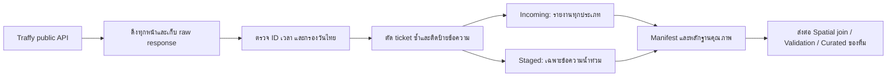

# Traffy Ingestion - คู่มือ Checkpoint ของสมาชิก 2

งานชุดนี้ครอบคลุม `ingest_traffy` รายวัน, backfill, กติกากรองน้ำท่วมจากข้อความ,
หลักฐานรันจริง และผลสุ่มตรวจ 100 รายงาน ตามหน้าที่ใน Proposal

## 1. สิ่งที่ทำและหลักฐานที่มี

| ส่วน | ไฟล์หลัก | หลักฐาน |
|---|---|---|
| API + pagination + retry | `src/traffy_client.py` | raw response ทุกหน้าและ manifest |
| รายวัน + Lambda | `src/ingest_traffy.py` | รัน Local ด้วยข้อมูลจริง, ทดสอบ Lambda/S3 ด้วย fixture |
| backfill แบบต่อจาก checkpoint | `src/backfill_traffy.py` | 24–26 ก.ย. 2569 และหลักฐานรันซ้ำ |
| กรองข้อความ | `src/traffy_filter.py` | กติกาเวอร์ชัน v1.0 พร้อมเหตุผลต่อรายงาน |
| ตรวจ 100 รายงาน | `scripts/review_traffy.py` | สุ่ม seed 341 และ AI อ่านตรวจครบ 100 ข้อความ |
| แพ็ก Lambda | `scripts/package_traffy.py` | ZIP และ isolated import ผ่าน |
| คู่มือส่งต่อ | `reference/traffy_schema_contract.md` | schema, timezone และข้อควรระวังการ join |

สถานะหลักฐาน: **ทดสอบข้อมูลจริงบน Local แล้ว ยังไม่ได้ deploy หรือ invoke บน AWS จริง**
การตรวจข้อความ 100 รายงานเป็น **AI review เบื้องต้น รอคนยืนยัน** ไม่มีการอ้างว่าคนตรวจแล้ว

## 2. โครงสร้าง Pipeline ปัจจุบัน



ใช้ `src/storage.py` จาก branch ThaiWater ร่วมกัน รองรับทั้ง Local และ S3
งาน Traffy อยู่บน `feature/ingest-traffy` ซึ่งต่อจาก `feature/ingest-thaiwater`
เพื่อใช้โครงสร้างร่วมกัน PR จึงควรเทียบกับ branch ThaiWater จนกว่างานฐานจะเข้า main

## 3. รันบนเครื่อง

เปิด terminal ที่ root repository ใช้ Python 3.12 ขึ้นไป
งาน Local ใช้ standard library เท่านั้น ส่วน S3 ใช้ `boto3`

```powershell
# ดึงวันไทยหนึ่งวัน
python -X utf8 -m src.ingest_traffy --date 2026-09-24 --backend local

# ดึงย้อนหลัง รวมวันเริ่มต้นและวันสิ้นสุด
python -X utf8 -m src.backfill_traffy --start 2026-09-24 --end 2026-09-26 --backend local

# รันช่วงเดิมอีกครั้ง ควรได้ SKIPPED เมื่อ checkpoint และ hash ถูกต้อง
python -X utf8 -m src.backfill_traffy --start 2026-09-24 --end 2026-09-26 --backend local

# อัปเดตข้อมูลจากต้นทางใหม่ เขียนทับ partition วันเดิม
python -X utf8 -m src.ingest_traffy --date 2026-09-24 --backend local --force

# เปลี่ยนที่เก็บข้อมูล Local ได้
python -X utf8 -m src.ingest_traffy --date 2026-09-24 --local-dir data_demo
```

ถ้าไม่ส่ง `--date` จะใช้ **เมื่อวานตามเวลาไทย** เพื่อเก็บวันเต็ม
วันปัจจุบันต้องระบุ `--allow-open-day` และจะไม่ถูกข้ามเป็นวันสมบูรณ์ในรอบถัดไป
`--page-size` ใช้ทดสอบการแบ่งหน้าได้ตั้งแต่ 1 ถึง 1000
ถ้าดึงไม่สำเร็จ CLI คืน exit code 1; backfill หยุดที่วันแรกที่ผิดพลาด
รันคำสั่งเดิมใหม่เพื่อข้ามวันที่สำเร็จและเริ่มต่อจากวันที่ยังไม่ครบ

## 4. ผลรันจริงชุดสาธิต

ช่วง **24–26 ก.ย. 2569 ตามวันไทย** จาก API สาธารณะ:

| วันไทย | รายงานทั้งหมด | เข้ากติกาน้ำท่วม | ไม่เข้ากติกา | กำกวม |
|---|---:|---:|---:|---:|
| 24 ก.ย. | 1,100 | 113 | 986 | 1 |
| 25 ก.ย. | 2,673 | 1,894 | 764 | 15 |
| 26 ก.ย. | 5,841 | 5,014 | 788 | 39 |
| รวม | **9,614** | **7,021** | **2,538** | **55** |

ตัวเลขนี้คือ **รายงานที่ API เปิดเผยและผลกติกาข้อความ** ไม่ใช่จำนวนเหตุการณ์น้ำท่วมที่ยืนยันแล้ว
รายละเอียดพร้อม hash และ warnings อยู่ใน `evidence/traffy/ingestion_summary.json`
และ `evidence/traffy/manifests/`

ข้อค้นพบที่ต้องอธิบายใน Demo:

- API รับ `start/end` เป็นวันที่ UTC แบบรวมวันปลายทาง ส่ง timestamp ระบุ `+00`
  การใส่เวลาในพารามิเตอร์ได้ HTTP 500 ในการทดสอบครั้งนี้
  จึงดึง UTC dates ที่ครอบคลุมวันไทย แล้วกรองช่วง `[00:00, 00:00 วันถัดไป)` ในระบบ
- API โฆษณา total มากกว่าที่ส่งจริง 40, 47 และ 69 รายการในแต่ละ query window
  ระบบดึงจนได้หน้าว่างจริงและบันทึกส่วนต่างไว้ เหตุผลของส่วนต่างยังไม่ทราบ
  ตัวเลขหน้าที่ดึงเป็นสองวัน UTC จึงไม่ควรนำมาบวกแทนจำนวนรายงานวันไทย
- การ replay ด้วย checkpoint ไม่เพิ่ม object ไม่เพิ่มจำนวนแถว และ hash คงเดิม
  ส่วน `--force` อาจได้ข้อมูลที่เปลี่ยนตามต้นทาง แต่ใช้ key วันเดิมเสมอ

ตรวจหลักฐาน Local และสร้าง ZIP ใหม่ได้ด้วย:

```powershell
python -X utf8 -m scripts.check_traffy_evidence --start 2026-09-24 --end 2026-09-26
```

คำสั่งนี้ตรวจ hash และ replay โดยห้ามเรียก network พร้อมทดลอง import handler
จาก ZIP ใน process ที่แยกจาก source tree โดยไม่ได้เรียก AWS

## 5. กติกากรองน้ำท่วม v1.0

ใช้ **description ของผู้แจ้ง** และประเภทปัญหาต้นทาง ไม่ใช้ `note` ตอบกลับของหน่วยงาน
เพราะข้อความตอบกลับอาจพูดถึงสถานการณ์ในวันอื่น

1. ปรับรูป Unicode ภาษาไทยและอักขระแฝงให้ค้นคำได้ตรงกัน เช่น `นํ้า`/`น้ำ`
2. หาคำบอกน้ำท่วมหรือขัง เช่น `น้ำท่วม`, `น้ำขัง`, `น้ำเข้าบ้าน`, `น้ำรอระบาย`
3. ตรวจคำปฏิเสธและป้องกันล่วงหน้าใกล้คำนั้น เช่น `ไม่มีน้ำท่วม` และ `ป้องกันน้ำท่วม`
4. ถ้ามีข้อความยืนยันอีกส่วนหนึ่ง เช่น “ขอป้องกันน้ำท่วม แต่ตอนนี้น้ำขังสูง” ยังนับเป็น flood
5. ถ้ากล่าวถึงอดีตอย่างเดียว น้ำประปารั่ว หรือมีเพียง category น้ำท่วมโดยไม่มีข้อความยืนยัน
   ให้เป็น `uncertain` ไม่บังคับเป็น flood
6. เก็บผลพร้อม `flood_reason`, คำที่พบ, คำที่ตัดออก และ `rule_version`

ผลลัพธ์สามค่า: `flood` = true, `non_flood` = false, `uncertain` = null
ไม่ควรแปลง null เป็น false โดยไม่รายงานจำนวนกำกวม

ข้อจำกัด: กติกาไม่เข้าใจบริบททั้งหมด ข้อความทั่วไปเกี่ยวกับหลายพื้นที่หรือช่องข้อความ
ที่ขัดกันอาจยังถูกนับเป็น flood ต้องแสดงผลตรวจตัวอย่างประกอบการใช้งาน
ไม่ใช้ข้อความนี้เพียงอย่างเดียวสั่งอพยพหรือสรุปสาเหตุน้ำท่วม

## 6. สุ่มตรวจ 100 รายงาน

```powershell
python -X utf8 -m scripts.review_traffy sample --start 2026-09-24 --end 2026-09-26 --count 100 --seed 341
python -X utf8 -m scripts.review_traffy evaluate --labels evidence/traffy/ai_review_labels.json
```

สุ่มแบบไม่ใส่คืนจากทุกประเภท 9,614 รายงาน ไม่เลือกเฉพาะที่กรองได้
ไฟล์ให้ผู้ตรวจอ่านไม่แสดง prediction/category เพื่อแยกการอ่านข้อความออกจากผลกติกา
รายการ ticket ID และ hash ของ population ถูกบันทึกเพื่ออ้างอิง snapshot เดิม

ผล AI review: flood 76, non_flood 18 และ uncertain 6
กติกาตรงกับ AI reference 94/100; อีก 6 คือ reference กำกวม แต่กติกาให้ flood 2 และ non_flood 4
**94% คือความตรงกันกับ AI review ชุดนี้ ไม่ใช่ความแม่นยำภาคสนามหรือผลยืนยันโดยคน**
ไม่มีการปรับกติกาตามผล 100 รายงานชุดนี้หลังการอ่านตรวจ
precision/recall ที่คำนวณในรายงานย่อยตัด reference กำกวมออกตามนิยามที่ระบุ
จึงไม่ควรหยิบค่า 100% ของกลุ่มย่อยมารายงานเป็นความแม่นยำรวม

ผลแก้ตาม Issue #5: รายงานหลักแสดง TP=76, FP=0 และ predicted positives ที่ยัง
ไม่แน่ใจ 2 รายงานจากทั้งหมด 78 รายงาน จึงแสดง **precision เป็นช่วง 97.44–100%**
เทียบกับ AI reference เบื้องต้น และยังไม่ให้ค่าเดียวจนกว่าจะตัดสินสองรายงานนั้นได้
ดูรายละเอียดล่าสุดใน `docs/traffy_issue5.md`

ให้คุณอ่าน `data/review/traffy/sample_100.json` ซึ่งมีข้อความเต็ม แล้วกรอก
`data/review/traffy/human_review_100.json`: ชื่อผู้ตรวจ, label และ rationale ครบทุกข้อ
และเปลี่ยน `status` เป็น `completed` เมื่อคุณตรวจเสร็จจริง
จากนั้นรัน:

```powershell
python -X utf8 -m scripts.review_traffy evaluate --labels data/review/traffy/human_review_100.json --output-dir evidence/traffy/human_review
```

ระบบไม่ยอมรับฟอร์มเปล่าเป็นผลตรวจเสร็จ หากต้นทางเปลี่ยนจน hash ไม่ตรง snapshot
ต้องเก็บ snapshot เดิมไว้หรือตั้งชุดสุ่มใหม่พร้อมตรวจใหม่ ไม่จับคู่ labels เก่ากับข้อความใหม่

ข้อมูลดิบและข้อความเต็มอยู่ใน path ที่ `.gitignore` กำหนดไว้
หลักฐานใน repository มี IDs, labels, เหตุผล และตัวเลขรวม โดยไม่คัดลอกรูป/ข้อความเต็ม/พิกัดบ้าน

## 7. เตรียมและ Deploy Lambda

```powershell
python -X utf8 -m scripts.package_traffy
```

ได้ `dist/ingest_traffy.zip` ที่ handler `src.ingest_traffy.lambda_handler`
แพ็กเฉพาะ Python modules ที่ต้องใช้ ไม่มี raw data, credentials หรือ sample API ของ ThaiWater
ตัว API client ใช้ standard library; S3 driver ใช้ Boto3 ที่ Lambda Python runtime มีให้
แนวทางนี้เหมาะกับ Checkpoint/Learner Lab; ระบบใช้งานระยะยาวควรจัดการเวอร์ชัน SDK อย่างชัดเจน

ตั้งค่าใน AWS:

| รายการ | ค่า |
|---|---|
| Runtime | Python 3.12 |
| Handler | `src.ingest_traffy.lambda_handler` |
| Timeout / Memory | 300 seconds / 256 MB |
| Role | LabRole ของทีม พร้อมสิทธิ์ S3 และ CloudWatch Logs |
| Environment | `STORAGE_BACKEND=s3`, `S3_BUCKET_NAME=<bucket ของทีม>` |
| Network | ต้องออก HTTPS ไปยัง public API ได้ |

ใช้ AWS CLI ที่ตั้งค่า Learner Lab ไว้แล้ว และแก้ bucket/region ให้ตรงทีม:

```powershell
.\infrastructure\deploy_traffy.ps1 -BucketName "cs341-tuamyang-data" -Region "us-east-1"
aws lambda invoke --function-name ingest_traffy --cli-binary-format raw-in-base64-out --payload file://infrastructure/traffy_lambda_event.json --region us-east-1 dist/traffy_lambda_result.json
```

ตรวจว่า invocation ไม่มี `FunctionError`, ผลเป็น SUCCESS/SKIPPED และมี object
ใน incoming/raw/checkpoints ตาม contract พร้อม CloudWatch log จริง
การทดสอบ S3 ใน unit tests เป็น SDK จำลอง จึงใช้แทนหลักฐาน AWS จริงไม่ได้

หากต้องการเปิด schedule รายวันของส่วนนี้ ใช้ `-EnableDailySchedule` เพิ่มในคำสั่ง deploy
จะตั้ง legacy EventBridge rule ตามรูปแบบที่มีอยู่ในงาน ThaiWater:
`cron(15 18 * * ? *)` = **01:15 เวลาไทยทุกวัน** เรียก Lambda ด้วย
`{"storage_backend":"s3"}` โดยให้ handler เลือกเมื่อวานเอง
Lambda จะ raise เมื่อดึงไม่สำเร็จเพื่อให้ retry ทำงาน ไม่ส่ง HTTP 200 กลบข้อผิดพลาด
ถ้า Learner Lab หยุด session หรือ schedule ไม่ทำงาน ให้ backfill วันที่ขาดภายหลัง

## 8. Demo ที่แนะนำและการส่งต่อ

1. เปิด diagram และอธิบายว่าข้อมูล Traffy ไปเชื่อม ThaiWater ผ่านวัน/ชั่วโมงและพื้นที่อย่างไร
2. รัน backfill ช่วงสาธิต เปิด raw หนึ่งหน้าและ incoming หนึ่ง partition
3. ชี้ให้เห็นรายงานทุกประเภท ตัวกรอง และ warnings ของ source total
4. รันคำสั่งเดิมซ้ำ แล้วแสดง SKIPPED และจำนวน/hash ก่อน–หลัง
5. เปิดผลตรวจ 100 รายงาน แสดงกรณีตรงและกรณีกำกวม พร้อมสถานะผู้ตรวจตามจริง
6. ส่ง contract ให้ผู้ทำ spatial join/validation/curated; ทีมแสดง query Q2 เบื้องต้นร่วมกัน

```powershell
python -X utf8 -m unittest tests.test_traffy tests.test_traffy_delivery -v

# ตรวจ regression ของงาน ThaiWater ด้วย โดยย้าย test log ไป temp
python -X utf8 -m scripts.test_traffy_checkpoint
```

PR description เตรียมไว้ใน `docs/pr_ingest_traffy.md`
ก่อนถือว่าส่วน AWS ผ่าน ให้แนบผล invoke และ CloudWatch/S3 จากบัญชีของทีมจริง
และให้คุณตรวจยืนยัน 100 รายงานตามแบบฟอร์มสำหรับหลักฐานที่อ้างว่าเป็น human review

## 9. การใช้ AI และความเป็นเจ้าของงาน

Codex ช่วยร่างและตรวจโค้ด ingestion, กติกาข้อความ, tests, คู่มือ และอ่านตรวจตัวอย่าง
100 รายงานในรอบนี้ การยืนยันผลประกอบด้วย unit tests, response จาก API จริง,
hash/count ก่อน–หลัง replay และการแยกข้อมูลจำลองออกจากหลักฐานข้อมูลจริง
สมาชิกผู้รับผิดชอบควรทดลองรัน อธิบาย pagination/timezone/filter และตรวจ labels
ด้วยตนเองก่อนนำไปสาธิต ไม่มีการสร้างหลักฐานการ deploy หรือ human review ขึ้นเอง

## แหล่งอ้างอิงและการตรวจสอบ

- API ที่ทดสอบจริง: <https://publicapi.traffy.in.th/share/teamchadchart/search>
  พารามิเตอร์และ timezone ในเอกสารนี้มาจาก response ที่เก็บไว้ใน raw ของรอบสาธิต
- Traffy Exchange API (เป็นคนละ endpoint; มีข้อกำหนดการจัดการข้อมูลดิบ):
  <https://exchange.traffy.in.th/docs.html>
- AWS Python Lambda ZIP/runtime dependencies:
  <https://docs.aws.amazon.com/lambda/latest/dg/python-package.html>
- AWS legacy EventBridge scheduled rules และ UTC:
  <https://docs.aws.amazon.com/eventbridge/latest/userguide/eb-create-rule-schedule.html>
